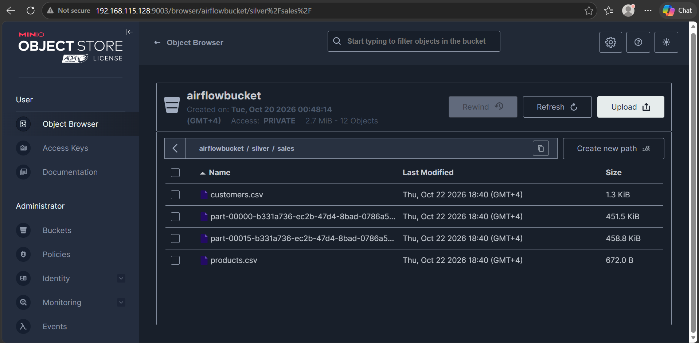
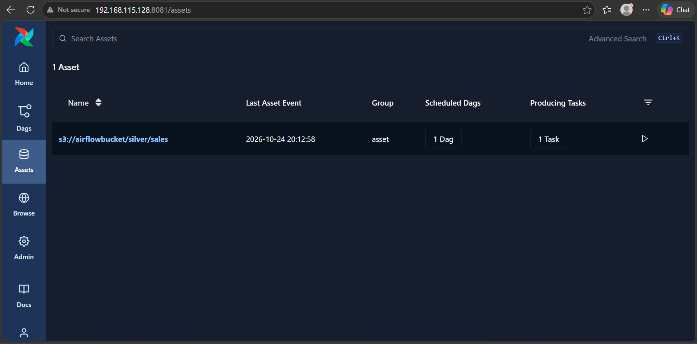
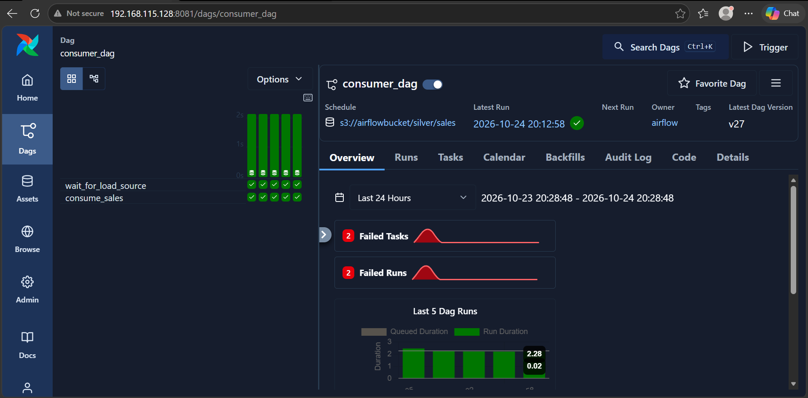
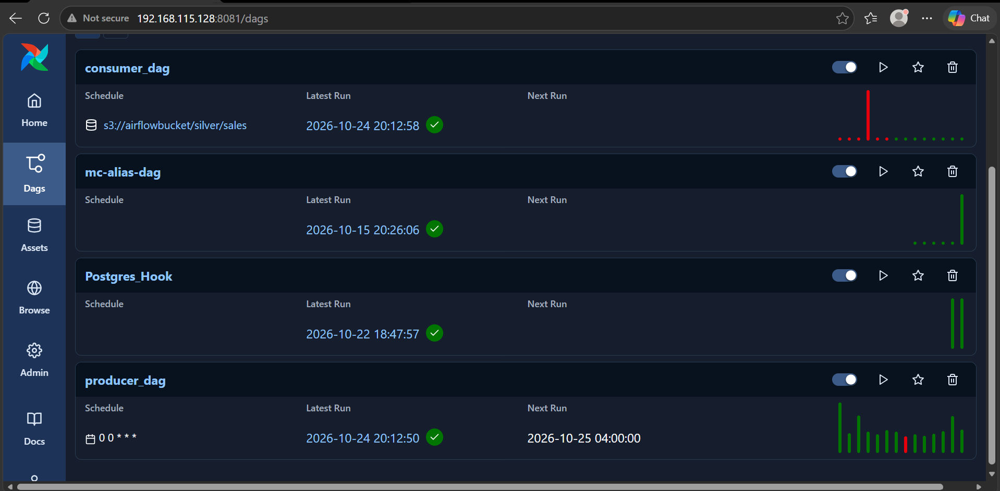
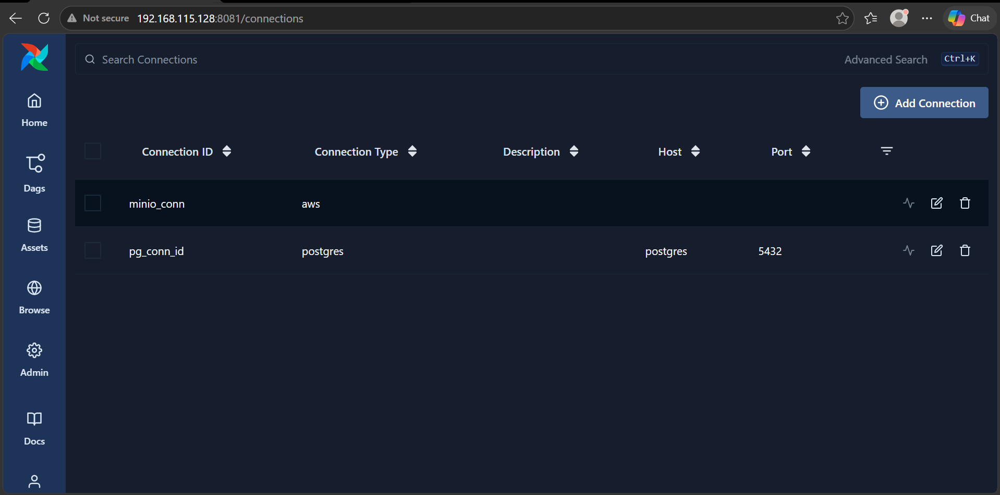
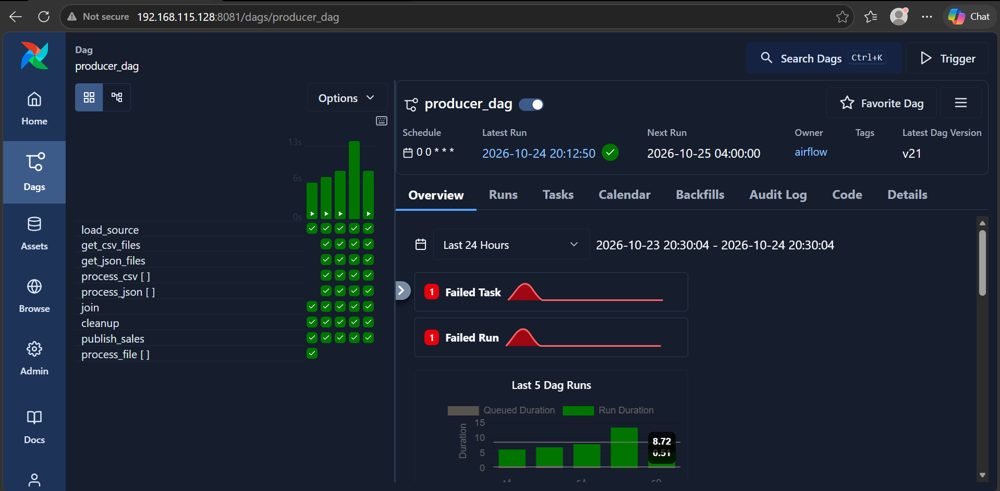

# Airflow və MinIO ilə Data Pipeline

Bu layihə Apache Airflow və MinIO istifadə edilərək hazırlanmış data engineering layihəsidir. Məqsəd MinIO-da saxlanılan CSV və JSON fayllarını aşkar etmək, onları Dynamic Task Mapping vasitəsilə emal etmək, DAG-lar arasında Asset əsaslı əlaqə yaratmaq və task asılılıqlarını idarə etməkdir.

## Layihənin məqsədi

Layihədə aşağıdakı mövzular tətbiq olunur:

- MinIO ilə Airflow arasında S3 connection yaratmaq.
- MinIO-dakı faylları siyahıya almaq.
- Dynamic Task Mapping ilə faylları dinamik emal etmək.
- CSV və JSON faylları üçün ayrıca emal task-ları yaratmaq.
- JOIN üçün `none_failed_min_one_success`, CLEANUP üçün `all_done` istifadə etmək.
- Producer və Consumer DAG-ları arasında Asset əsaslı əlaqə yaratmaq.
- `ExternalTaskSensor` ilə başqa DAG-dakı task-ı gözləmək.
- `catchup` və 3 günlük backfill planını izah etmək.
- Deferrable sensor və Triggerer mexanizmini öyrənmək.

## İstifadə olunan texnologiyalar

| Texnologiya | İstifadə məqsədi |
|---|---|
| Apache Airflow 3.1.0 | DAG və task-ların idarə edilməsi |
| Docker | Servislərin konteynerlərdə işlədilməsi |
| Docker Compose | Çoxsaylı servislərin birlikdə başladılması |
| MinIO | S3-compatible object storage |
| PostgreSQL 16 | Airflow metadata bazası |
| Python | Task-ların və emal məntiqinin yazılması |

## Layihənin strukturu

```text
airflow-minio-project/
├── Dockerfile
├── docker-compose.yml
├── requirements.txt
├── data/
│   ├── customers.csv
│   ├── products.csv
│   ├── part-00000-b331a736-ec2b-47d4-8bad-0786a5055d8c-c000.json
│   └── part-00015-b331a736-ec2b-47d4-8bad-0786a5055d8c-c000.json
├── airflow/
│   └── dags/
│       ├── consumer.py
│       └── producer.py
└── screenshots/
    ├── airflowbucket.png
    ├── assets.png
    ├── consumer_dag.png
    ├── dags.png
    ├── minio_conn.png
    └── producer_dag.png
```

## Layihənin arxitekturası

Layihədə iki əsas DAG mövcuddur:

**Producer DAG**
- MinIO-dan faylların siyahısını əldə edir.
- Faylları CSV və JSON formatlarına görə ayırır.
- Dynamic Task Mapping vasitəsilə fayllar üçün task instansiyaları yaradır.
- JOIN və CLEANUP mərhələlərini icra edir.
- `sales` asset event-i yayımlayır.

**Consumer DAG**
- `sales` asset event-i əsasında işə düşür.
- `ExternalTaskSensor` ilə Producer DAG-dakı `load_source` task-ının tamamlanmasını gözləyir.
- Daha sonra `consume_sales` task-ını icra edir.

```text
MinIO: airflowbucket/bronze/
              |
              v
          load_source
              |
       +------+------+
       |             |
       v             v
 get_csv_files   get_json_files
       |             |
       v             v
 process_csv    process_json
       |             |
       +------+------+
              |
             join
              |
           cleanup
              |
              v
        publish_sales
              |
          sales Asset
              |
              v
         consumer_dag
              |
     ExternalTaskSensor
              |
              v
        consume_sales
```

## 1. MinIO connection və faylların siyahıya alınması

Producer DAG-da MinIO ilə əlaqə yaratmaq üçün `S3Hook` istifadə edilir:

```python
s3 = S3Hook(aws_conn_id="minio_conn")

files = s3.list_keys(
    bucket_name="airflowbucket",
    prefix="bronze/"
) or []
```

`load_source` task-ı `airflowbucket` bucket-ində `bronze/` prefiksinə uyğun obyektləri siyahıya alır.

Daha sonra fayllar uzantılarına görə ayrılır:

```python
csv_files = [
    f for f in files
    if f.lower().endswith(".csv")
]

json_files = [
    f for f in files
    if f.lower().endswith(".json")
]
```

### Airflow connection konfiqurasiyası

Airflow UI-də **Admin → Connections** bölməsində aşağıdakı parametrlərə uyğun connection yaradılır:

| Parametr | Dəyər |
|---|---|
| Connection ID | `minio_conn` |
| Connection Type | `Amazon Web Services` |
| Endpoint URL | `http://minio:9000` |
| AWS Access Key ID | MinIO access key |
| AWS Secret Access Key | MinIO secret key |
| Region | `us-east-1` |

`http://minio:9000` Docker şəbəkəsində MinIO servisinə qoşulmaq üçün istifadə edilir. Host kompüterdən MinIO API-yə `http://localhost:9002`, Console-a isə `http://localhost:9003` ünvanından daxil olmaq mümkündür.

## 2. Dynamic Task Mapping və CSV/JSON emalı

Dynamic Task Mapping runtime zamanı alınan məlumat əsasında dinamik task instansiyaları yaratmağa imkan verir.

Layihədə fayllar iki siyahıya ayrılır:

```python
csv_files = get_csv_files(files)
json_files = get_json_files(files)
```

Sonra hər siyahı üçün ayrıca dinamik task-lar yaradılır:

```python
csv_result = process_csv.expand(file=csv_files)
json_result = process_json.expand(file=json_files)
```

Məsələn, MinIO-da 3 CSV və 2 JSON faylı varsa, Airflow 3 CSV və 2 JSON emal task instansiyası yarada bilər.

Qeyd: hazırkı `process_csv` və `process_json` task-ları fayl adlarını log-a yazır. Faylların daxilindəki məlumatların faktiki oxunması və transformasiyası bu nümunəyə daxil edilməyib.

Bu layihədə CSV və JSON üçün ayrıca dinamik task qrupları yaradılır. Bu, `BranchPythonOperator` ilə şərti branch seçilməsi ilə eyni mexanizm deyil.

## 3. JOIN və CLEANUP üçün Trigger Rules

### JOIN — `NONE_FAILED_MIN_ONE_SUCCESS`

```python
join = EmptyOperator(
    task_id="join",
    trigger_rule=TriggerRule.NONE_FAILED_MIN_ONE_SUCCESS
)
```

Bu qayda upstream task-lardan ən azı birinin uğurla tamamlanmasını və heç birinin `failed` vəziyyətində olmamasını tələb edir.

Əgər CSV və ya JSON siyahılarından biri boş olduğuna görə həmin branch `skipped` olarsa, digər branch uğurla tamamlandıqda JOIN işləyə bilər.

### CLEANUP — `ALL_DONE`

```python
cleanup = EmptyOperator(
    task_id="cleanup",
    trigger_rule=TriggerRule.ALL_DONE
)
```

Bu qayda bütün upstream task-lar tamamlandıqdan sonra CLEANUP task-ının işləməsinə imkan verir. Upstream task-ların uğurlu və ya uğursuz olması CLEANUP-ın işə düşməsi üçün maneə deyil.

Hazırkı layihədə CLEANUP `EmptyOperator` olduğuna görə real təmizləmə əməliyyatı aparmır; yalnız trigger rule davranışını nümayiş etdirir.

## 4. Producer DAG və Asset əsaslı Consumer DAG

Layihədə istifadə edilən asset:

```python
sales_asset = Asset(
    "s3://airflowbucket/silver/sales"
)
```

Producer DAG-da `publish_sales` task-ı bu asset-i yayımlayır:

```python
@task(outlets=[sales_asset])
def publish_sales():
    context = get_current_context()

    yield Metadata(
        sales_asset,
        {
            "producer_date":
                context["logical_date"].isoformat()
        }
    )

    print("Sales asset")
```

`publish_sales` uğurla tamamlandıqda Airflow asset event yaradır. Event daxilində Producer DAG-ın logical date məlumatı saxlanılır.

Consumer DAG həmin asset-i schedule kimi istifadə edir:

```python
@dag(
    dag_id="consumer_dag",
    start_date=datetime(2026, 1, 1),
    schedule=[sales_asset],
    catchup=False,
)
def consumer():
    ...
```

Beləliklə, Consumer DAG uyğun asset event yarandıqda işə düşür.

**Qeyd:** Asset event yayımlamaq həmin S3 ünvanına avtomatik olaraq məlumat yazmır. Hazırkı `publish_sales` task-ı event yayımlayır, lakin `s3://airflowbucket/silver/sales` ünvanına faktiki fayl yazmır. Real data pipeline üçün əvvəlcə məlumatın həmin ünvana yazılması təmin edilməlidir.

## 5. `catchup` qərarı və 3 günlük backfill planı

Producer DAG aşağıdakı konfiqurasiyadan istifadə edir:

```python
@dag(
    dag_id="producer_dag",
    start_date=datetime(2026, 1, 1),
    schedule="@daily",
    catchup=False,
)
```

### Niyə `catchup=False`?

`catchup=False` DAG aktivləşdirildikdə `start_date` tarixindən bu günə qədər olan bütün buraxılmış gündəlik interval­lar üçün avtomatik tarixi run-ların yaradılmasının qarşısını alır.

Bu tədris layihəsində yalnız cari schedule üzrə işləmək və lazımsız tarixi run-ları azaltmaq üçün uyğundur.

Ancaq `catchup=False` tarixi məlumatların yenidən emalına mane olmur. Bunun üçün ayrıca backfill prosesi planlaşdırıla bilər.

### 3 günlük backfill planı

Məsələn, 21–23 oktyabr 2026 tarixləri üzrə məlumatların yenidən emal edilməsi tələb olunarsa:

| Tarix | Plan |
|---|---|
| 21 oktyabr | Birinci günün fayllarını yoxlamaq və emal etmək |
| 22 oktyabr | İkinci günün fayllarını yoxlamaq və emal etmək |
| 23 oktyabr | Üçüncü günün fayllarını yoxlamaq və emal etmək |

Airflow-un backfill CLI əmri:

```bash
docker compose exec airflow-scheduler \
  airflow dags backfill \
  --start-date 2026-10-21 \
  --end-date 2026-10-23 \
  producer_dag
```

Tarixlər nümunədir və faktiki məlumat intervalına uyğun dəyişdirilməlidir. Gündəlik DAG intervalı üzrə yaradılan run-ların logical date-ləri yoxlanılmalıdır.

Backfill zamanı:

1. MinIO-da həmin tarixlərə uyğun faylların mövcudluğu yoxlanılır.
2. Tarixi run-lar başladılır.
3. Hər run-ın task nəticələri yoxlanılır.
4. Təkrar emal zamanı dublikatların yaranmasının qarşısı alınır.
5. Cari gündəlik schedule-ın normal işlədiyi təsdiqlənir.

**Vacib:** Hazırkı `load_source` bütün `bronze/` prefiksini oxuyur. Tarixə görə həqiqi backfill üçün faylların tarixə görə filtrlənməsi və təkrar emala qarşı qoruma əlavə edilməlidir. Həmçinin Consumer DAG-ın hər tarixi event üçün gözlənilən qaydada işə düşməsi ayrıca yoxlanılmalıdır.

## 6. `ExternalTaskSensor` ilə `load_source` task-ını gözləmək

Consumer DAG daxilində başqa DAG-dakı task-ın tamamlanmasını gözləmək üçün `ExternalTaskSensor` istifadə olunur:

```python
wait_for_load_source = ExternalTaskSensor(
    task_id="wait_for_load_source",
    external_dag_id="producer_dag",
    external_task_id="load_source",
    execution_date_fn=get_producer_date,
    allowed_states=["success"],
    failed_states=["failed"],
    mode="reschedule",
    poke_interval=10,
    timeout=600,
    check_existence=True,
)
```

Parametrlərin izahı:

- `external_dag_id`: gözlənilən DAG — `producer_dag`.
- `external_task_id`: gözlənilən task — `load_source`.
- `execution_date_fn`: uyğun Producer run-ının logical date-ini müəyyən edir.
- `allowed_states=["success"]`: task uğurla tamamlandıqda sensor davam edir.
- `failed_states=["failed"]`: task uğursuz olduqda sensor uğursuzluq vəziyyətinə keçir.
- `mode="reschedule"`: gözləmə zamanı worker slot-unu daimi tutmur, növbəti yoxlama üçün yenidən planlaşdırılır.
- `poke_interval=10`: yoxlama intervalı 10 saniyədir.
- `timeout=600`: maksimum gözləmə müddəti 600 saniyədir.
- `check_existence=True`: xarici DAG və task-ın mövcudluğunu yoxlamağa kömək edir.

`get_producer_date` funksiyası asset event-in `producer_date` metadata-sını oxuyaraq uyğun Producer logical date-ini seçmək üçün nəzərdə tutulub.

## 7. Deferrable sensor və Triggerer

Sensorlar başqa task-ın və ya hadisənin baş verməsini gözləmək üçün istifadə olunur.

### `reschedule` və `deferrable` fərqi

- **Poke rejimi:** sensor yoxlamalar arasında worker slot-unu saxlayır.
- **Reschedule rejimi:** sensor yoxlamalar arasında worker slot-unu azad edir.
- **Deferrable rejim:** dəstəklənən sensor gözləmə məntiqini Triggerer-ə ötürür və worker resurslarının istifadəsini azaldır.

Hazırkı `consumer.py` faylında sensor `mode="reschedule"` ilə işləyir. Bu, deferrable rejim deyil.

Deferrable rejimi dəstəkləyən sensor üçün nümunə:

```python
sensor = ExternalTaskSensor(
    task_id="wait_for_load_source",
    external_dag_id="producer_dag",
    external_task_id="load_source",
    execution_date_fn=get_producer_date,
    allowed_states=["success"],
    failed_states=["failed"],
    deferrable=True,
    poke_interval=10,
    timeout=600,
)
```

### Triggerer nədir?

Triggerer Airflow-un deferrable task-lar üçün gözləmə proseslərini idarə edən komponentidir. Sensor gözləmə vəziyyətinə keçdikdə Triggerer asinxron şəkildə hadisəni izləyə bilər. Şərt ödənildikdə task icrasına davam edir.

Docker Compose-a aşağıdakı servisi əlavə etmək olar:

```yaml
airflow-triggerer:
  <<: *airflow-common
  command: triggerer
  container_name: airflow-triggerer
  networks:
    - lake
  restart: always
  depends_on:
    <<: *airflow-common-depends-on
    airflow-init:
      condition: service_completed_successfully
```

Sonra servisləri yenidən başladırıq:

```bash
docker compose up -d --build
docker compose ps
docker compose logs airflow-triggerer
```

Triggerer-in işləməsi ilə yanaşı, istifadə olunan Airflow provider versiyasının `ExternalTaskSensor` üçün `deferrable=True` parametrini dəstəkləməsi də yoxlanılmalıdır.

## 8. Docker mühitinin işə salınması

### Tələblər

- Docker
- Docker Compose
- Git

### Repository-ni klonlamaq

```bash
git clone https://github.com/USERNAME/airflow-minio-project.git
cd airflow-minio-project
```

`USERNAME` hissəsini öz GitHub istifadəçi adınla əvəz et.

### Servisləri başlatmaq

Layihənin kök qovluğunda `.env` faylı konfiqurasiya edildikdən sonra:

```bash
docker compose up -d --build
```

Servislərin vəziyyətini yoxlamaq:

```bash
docker compose ps
```

Scheduler log-larına baxmaq:

```bash
docker compose logs -f airflow-scheduler
```

### İdarəetmə ünvanları

| Servis | Ünvan |
|---|---|
| Airflow UI | http://localhost:8081 |
| MinIO API | http://localhost:9002 |
| MinIO Console | http://localhost:9003 |
| PostgreSQL | `localhost:5436` |

Giriş məlumatları `.env` və Airflow administrator konfiqurasiyası ilə uyğun olmalıdır. Real mühitdə standart və ya sadə parollardan istifadə edilməməlidir.

## 9. Dockerfile və Python paketləri

Dockerfile `apache/airflow:3.1.0` image-ından istifadə edir, `git`, `bash`, `curl`, `unzip` paketlərini quraşdırır və MinIO Client (`mc`) binary faylını image-a əlavə edir.

`requirements.txt` faylında Airflow provider paketləri müəyyən edilir.

DAG-larda `S3Hook` istifadə olunduğuna görə `apache-airflow-providers-amazon` paketinin də quraşdırılması vacibdir.

```text
apache-airflow-providers-amazon
apache-airflow-providers-standard
apache-airflow-providers-common-sql
apache-airflow-providers-postgres
apache-airflow-providers-fab
apache-airflow-providers-smtp
```

Paket siyahısı dəyişdirildikdən sonra image yenidən build edilməlidir:

```bash
docker compose up -d --build
```

## 10. Screenshot-lar

Bu bölmədə layihənin MinIO konfiqurasiyası, Airflow UI-si və DAG-ların qrafik görünüşləri göstərilir. Şəkillər `screenshots/` qovluğunda saxlanılır.

### 10.1. MinIO Bucket — `airflowbucket.png`



Bu screenshot MinIO Console-da `airflowbucket` bucket-ini və ya bucket daxilindəki obyektləri göstərir. Burada Bronze qatında saxlanılan CSV və JSON fayllarının yerləşməsini müşahidə etmək mümkündür.

### 10.2. Airflow Assets — `assets.png`



Bu şəkil Airflow Asset mexanizmini nümayiş etdirir. Producer DAG tərəfindən yayımlanan `sales` asset-i Consumer DAG-ın işə düşməsi üçün istifadə olunur.

### 10.3. Consumer DAG — `consumer_dag.png`



Consumer DAG-ın qrafik görünüşüdür. Burada `wait_for_load_source` sensorunun və `consume_sales` task-ının asılılığı göstərilir. Sensor Producer DAG-dakı `load_source` task-ının tamamlanmasını gözləyir.

### 10.4. DAG siyahısı — `dags.png`



Airflow UI-də mövcud DAG-ların siyahısını göstərir. Burada `producer_dag` və `consumer_dag` layihənin əsas workflow-ları kimi görünə bilər.

### 10.5. MinIO Connection — `minio_conn.png`



Airflow ilə MinIO arasında yaradılan `minio_conn` connection-ının konfiqurasiyasını nümayiş etdirir. Connection `S3Hook` vasitəsilə MinIO-dakı faylları siyahıya almaq üçün istifadə olunur.

### 10.6. Producer DAG — `producer_dag.png`



Producer DAG-ın qrafik görünüşüdür. `load_source`, CSV və JSON fayllarının ayrılması, dinamik emal task-ları, JOIN, CLEANUP və `publish_sales` mərhələləri arasındakı asılılıqları göstərir.

## 11. Yoxlama siyahısı

- [ ] MinIO-da `airflowbucket` bucket-i mövcuddur.
- [ ] CSV və JSON faylları `bronze/` prefiksi altında saxlanılır.
- [ ] Airflow-da `minio_conn` connection-ı yaradılıb.
- [ ] `load_source` faylları siyahıya alır.
- [ ] Dynamic Task Mapping fayllara uyğun task instansiyaları yaradır.
- [ ] JOIN üçün `NONE_FAILED_MIN_ONE_SUCCESS` istifadə olunur.
- [ ] CLEANUP üçün `ALL_DONE` istifadə olunur.
- [ ] Producer `sales` asset event-ini yayımlayır.
- [ ] Consumer DAG asset event-i əsasında işə düşür.
- [ ] `ExternalTaskSensor` uyğun Producer run-ını gözləyir.
- [ ] `catchup=False` seçiminin səbəbi izah olunub.
- [ ] 3 günlük backfill planı hazırlanıb.
- [ ] Deferrable sensor və Triggerer tələbi izah olunub.
- [ ] Screenshot-lar GitHub-da düzgün görünür.

## Nəticə

Bu layihə Apache Airflow və MinIO inteqrasiyasını, Dynamic Task Mapping, trigger rules, Asset əsaslı DAG scheduling və `ExternalTaskSensor` mexanizmlərini öyrənmək üçün hazırlanmış tədris layihəsidir.

Layihə həmçinin `catchup`, backfill, reschedule və deferrable sensor anlayışlarını izah edərək data engineering workflow-larının qurulması barədə praktiki biliklər əldə etməyə kömək edir.
